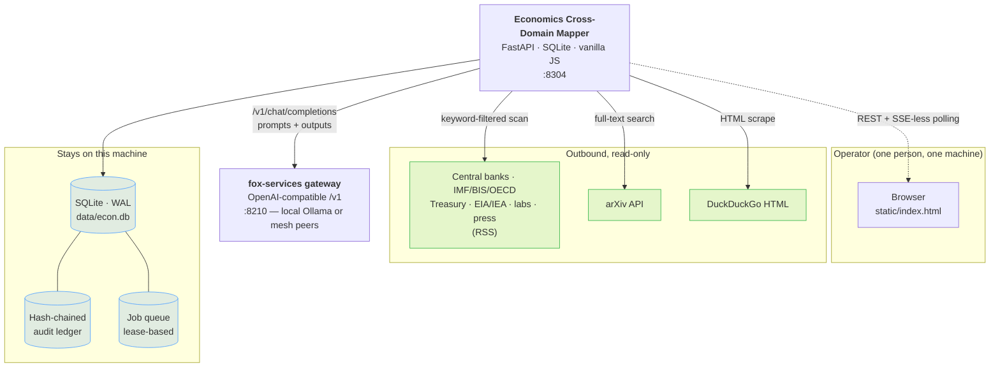
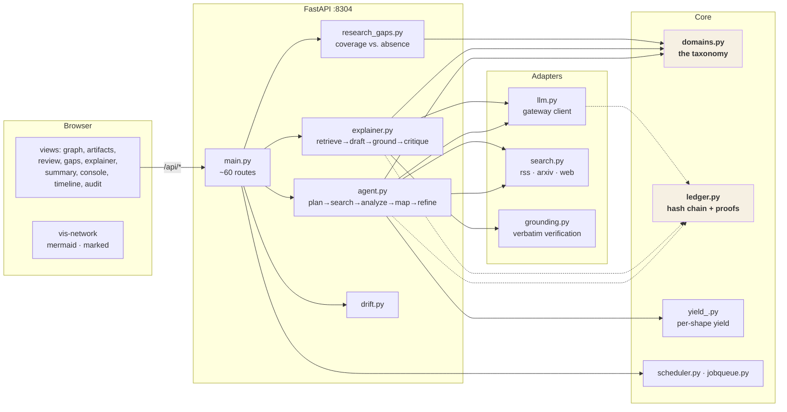

# System context

## Level 1 — the app in its world

**Nothing sensitive leaves.** The only outbound traffic is read-only requests
to public endpoints and model inference to a gateway on the operator's own
network. There is no telemetry endpoint, no outbound webhook, and no third-party
service.

## Level 2 — containers

## Components

| Module | Responsibility | Depends on |
|---|---|---|
| `domains.py` | The taxonomy: 11 domains, 30+ channels, 13 drivers, relationship types, entity aliases | nothing |
| `models.py` | Investigation, Artifact, Relationship, AgentRun, Explanation, ResearchGap, Job | `database` |
| `ledger.py` / `ledger_models.py` | Hash chain, mandates, proofs, claims, sessions, exports | `database` |
| `ledger_api.py` | The audit surface as its own router | `ledger` |
| `agent.py` | The collection loop | `domains`, `llm`, `search`, `yield_`, `ledger` |
| `explainer.py` | Retrieval, drafting, critique, roadmap | `domains`, `llm`, `grounding`, `ledger` |
| `grounding.py` | Verbatim quote verification, PII, relevance gate | nothing |
| `research_gaps.py` | Coverage, gaps vs. thin, unbridged channels | `domains`, `explainer` |
| `search.py` | RSS / arXiv / DuckDuckGo, economics-first feeds | nothing |
| `yield_.py` | Per-shape query yield across runs | `models` |
| `jobqueue.py` | Persisted, lease-based queue | `models` |
| `scheduler.py` | Cron, validated at set time | `models`, `jobqueue` |
| `main.py` | The API | all of the above |

## The dependency rule that keeps it honest

`domains.py` imports **nothing**. The taxonomy is the one module that every
other module depends on and that depends on none, which is what lets it be
changed in one place and be trusted everywhere. `grounding.py` is the same:
pure functions, no I/O, so the guarantee it makes can be tested without a
database or a network.

Everything that could fail (the LLM, the search providers, the database) is
imported *inside* the function that needs it. That is why a gateway outage
degrades the explainer to a refusal rather than a 500.