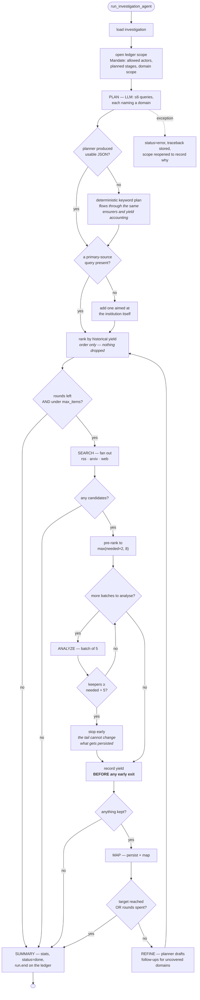
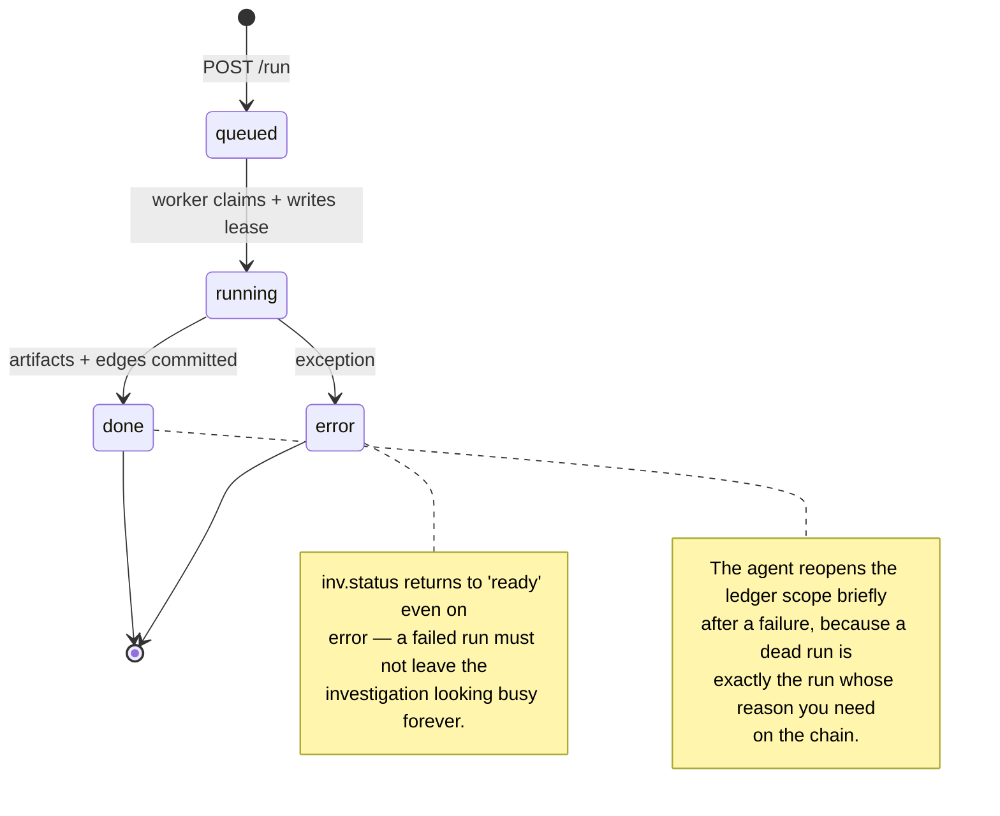
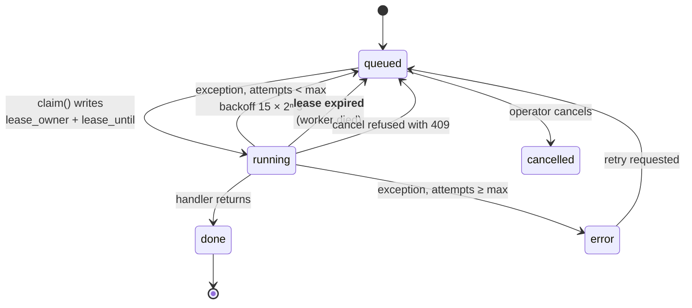
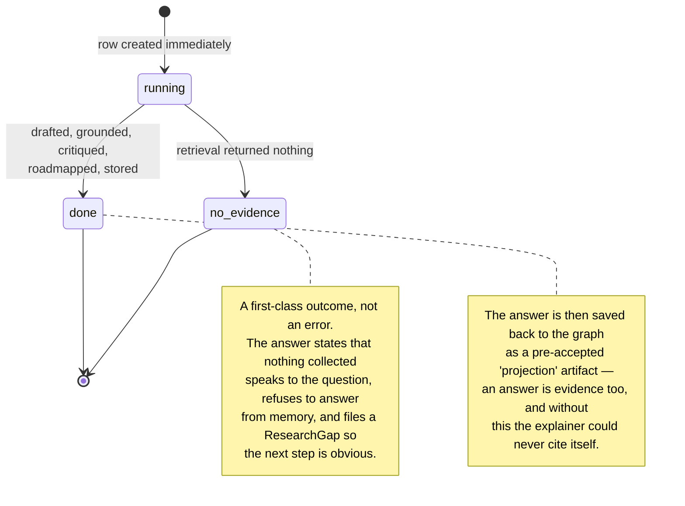
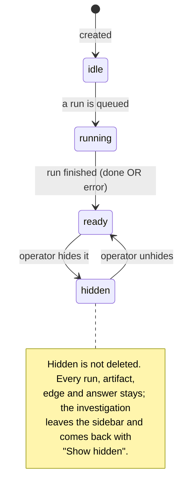
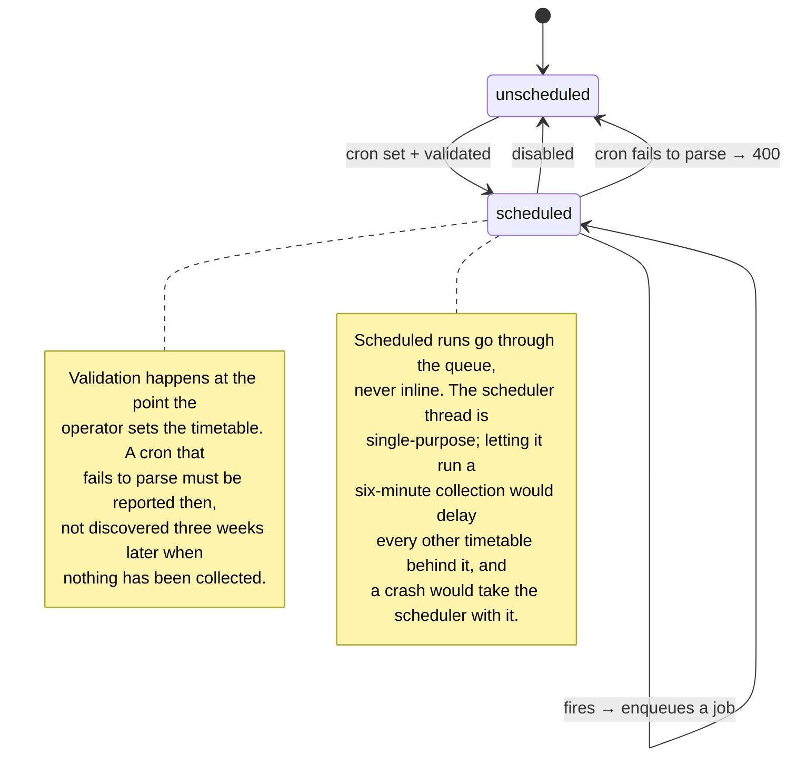
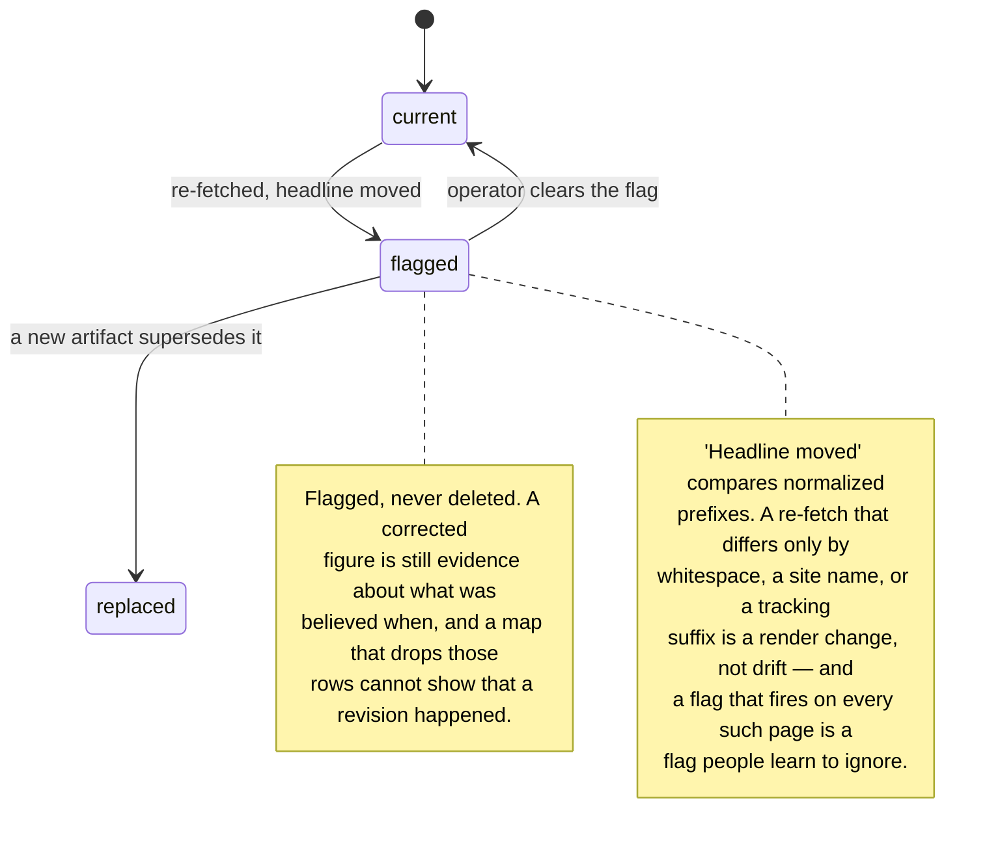

# Activity and state

## Collection loop — the decision structure

The ordering constraint that matters: **yield is recorded before every early
exit.** A round that analyzed candidates and kept none is the single most
useful thing to remember, and it is exactly the round that leaves no trace if
you record yield at the end.

## Run states

## Job states

**A lease, not a lock.** Claiming writes the worker's id and a deadline. A
worker that dies stops renewing; the lease expires and the job is re-queued.
Nothing has to notice that a process crashed — which is the only mechanism that
works when the thing that crashed is the thing that would have noticed.

`recover_stale()` runs at startup and re-queues anything whose lease expired
while the process was down.

**A running job cannot be cancelled.** The API returns `409` and explains why:
the worker holds no cooperative cancellation point, and killing it would strand
the lease until it expires. The honest answer is "wait for the lease", not a
button that pretends.

## Explanation states

## Investigation states

## Scheduler

## Drift states

