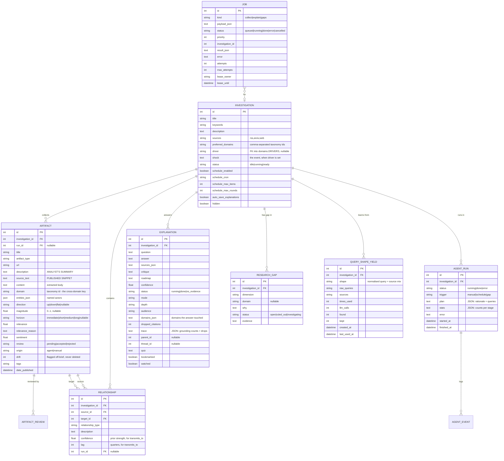
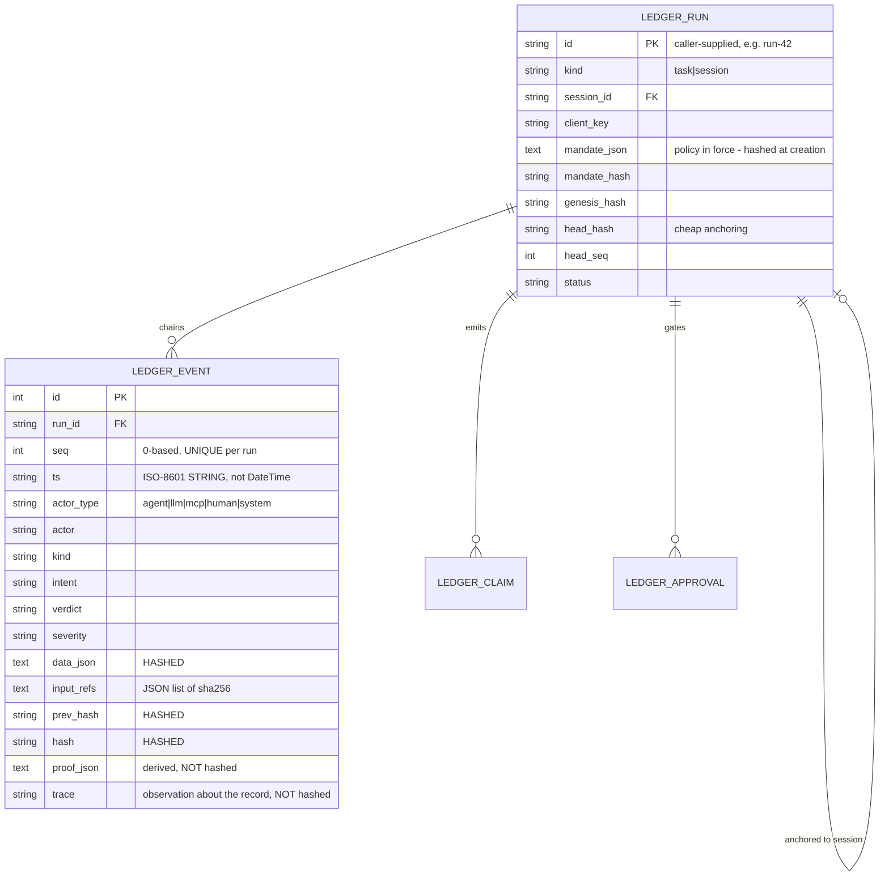

# Data model

## Entities

## The ledger (separate shape, separate module)

## Why these shapes

### `description` and `source_text` are separate columns

This is the single most consequential modelling decision in the file.

`description` is the **analyst's summary** — one or two sentences the model
wrote. `source_text` is the **published snippet**, as the source itself
rendered it.

Grounding verifies every quote against `source_text`. Verifying against the
summary would be circular: the model could quote the summary back at the
checker and pass without ever having read the source, while a quote genuinely
lifted from the article would fail because the paraphrase paraphrased it. Both
are wrong, and they fail in opposite directions — which means a checker built
on the summary is not merely noisy, it is anti-correlated with truth.

Artifacts collected before the split fall back to the summary, and the
explainer's trace records which sources that applied to, so a drop count never
silently mixes a hallucination with a data gap.

### `ts` is a string, not a `DateTime`

Audit needs the exact authored timestamp with its offset preserved, and
lexicographic order must equal chronological order for the timeline to sort
without a timezone library. A `DateTime` normalises that away.

### `proof_json` and `trace` are outside the hashed core

Both are *observations about the record*, not part of what the record claims.
`proof_json` is recomputable — verification re-derives it and reports drift
rather than trusting it. `trace` says which request wrote the row. Folding
either into `data_json` would change every event hash already on disk and break
verification of every run ever recorded.

### `direction` / `magnitude` / `horizon` are columns, not prose

"Rates up" is not an insight. `up · 0.6 · medium` is something a transmission
chain can be built on and something the summary can rank. Keeping them
structured means the strongest-signal view needs no language model to rank, and
means an artifact with no reading is visibly *background* rather than quietly
counted as a finding.

### `drift` is a flag, not a deletion

A corrected figure is still evidence about what was believed when. A map that
silently drops those rows cannot show that a revision happened.

### `domain` is the cross-domain key

`preferred_domains` on the investigation says what the operator *asked* about.
`domain` on the artifact says what the agent *found*. Those are different
questions, and conflating them is how a map ends up claiming coverage it does
not have. Coverage is computed from the artifact column, always.

## Migration policy

`database._MIGRATIONS` is an additive `ALTER TABLE` list applied at startup.
`create_all` never adds a column to an existing table, so every later addition
lives there.

Additive only, deliberately. A destructive migration would take an
investigation's artifacts with it, and the entire value of the app is what it
has already collected.