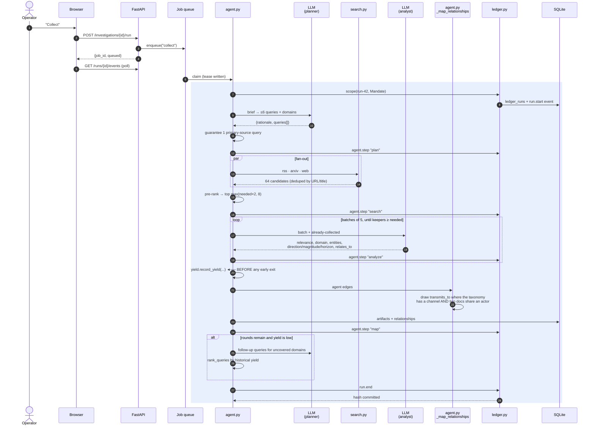
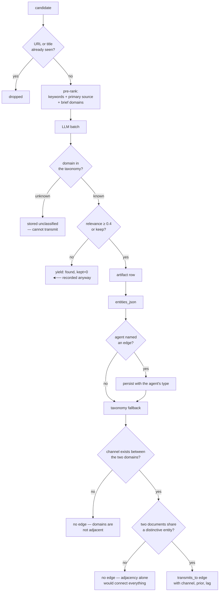
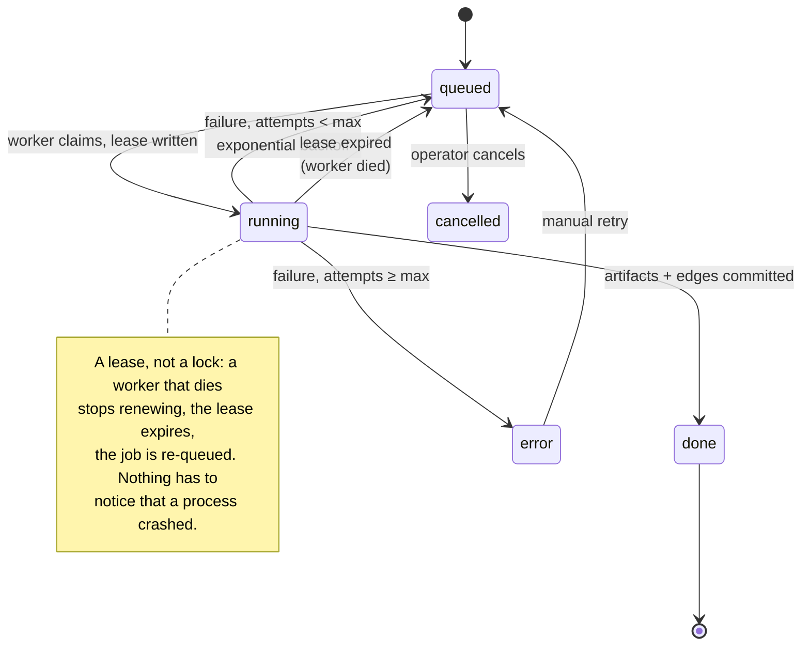

# Interaction — one collection run, end to end

## Sequence

## Where the guarantees live

The two `no` branches on the right are the design. A graph that drew an edge
whenever the taxonomy said a channel existed would connect every document in
every pair of adjacent domains, which is a picture of the taxonomy rather than
of the evidence. The result of refusing is that the channel shows up in
**Research gaps → unbridged channels**: "both endpoints are covered, but
nothing connects them" — which is a finding, and an actionable one.

## Failure paths

| Failure | Behaviour | Why |
|---|---|---|
| Gateway unreachable at plan | Deterministic keyword-derived plan | A run must never fail because a model did; the fallback flows through the same ensurers and the same yield accounting as a model plan |
| Model returns unparseable JSON | `_parse_json_lenient` repairs fences, control chars, prose wrappers, trailing commas | Small models break JSON constantly; strict parsing turns a cosmetic defect into a total failure |
| Every source fails | Round records `found=0` in yield and the loop breaks | The zero is the useful datum — it is what stops the shape being re-proposed next run |
| Worker dies mid-run | Lease expires, job is re-queued, `attempts` increments | A crash is indistinguishable from a slow run from outside; a lease distinguishes them |
| Ledger write fails | Record lands in `LedgerAuditDrop`, work continues | Auditing is fail-open. A hole that exists only on stderr is a hole nobody reads |
| Ledger write fails repeatedly | Integrity monitor reports `audit_drops > 0` alongside a perfectly verified chain | A chain can verify while the recorder has been failing for hours. Both numbers are reported, because neither alone is sufficient |