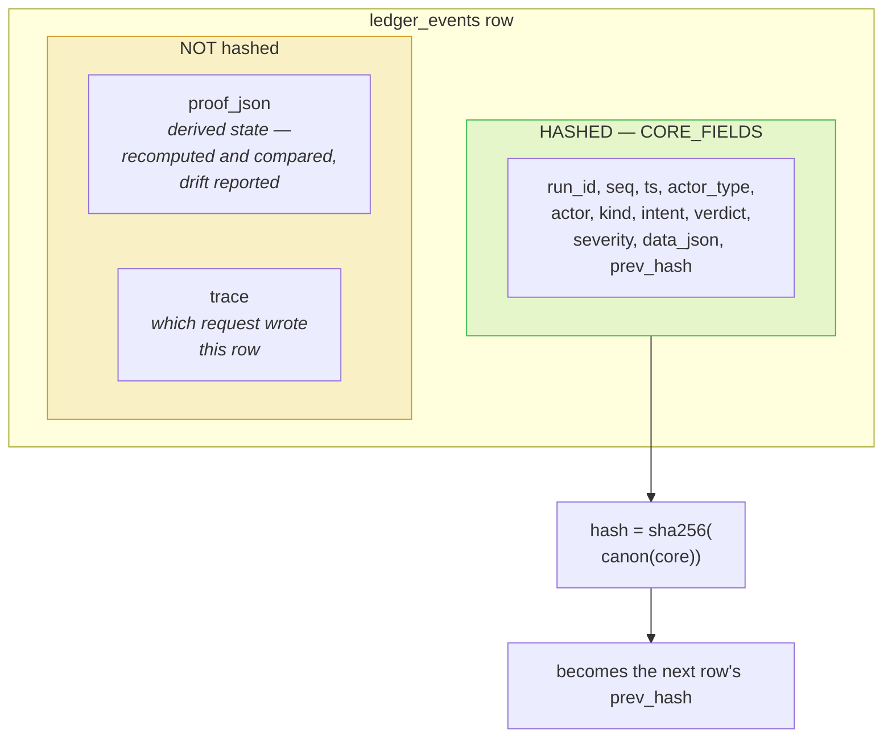
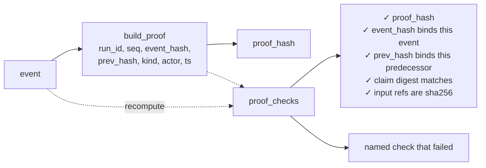
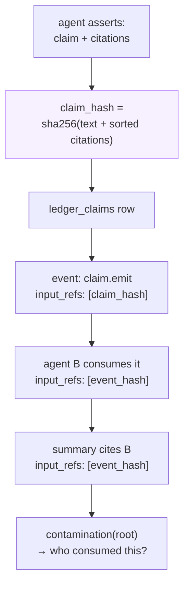
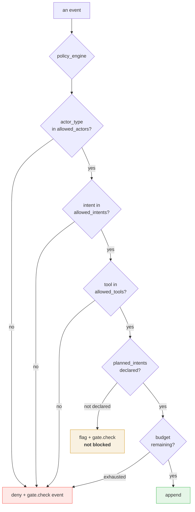
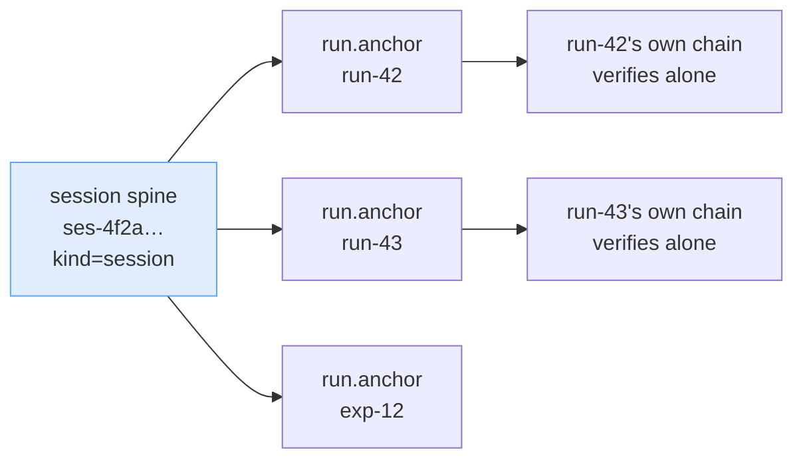
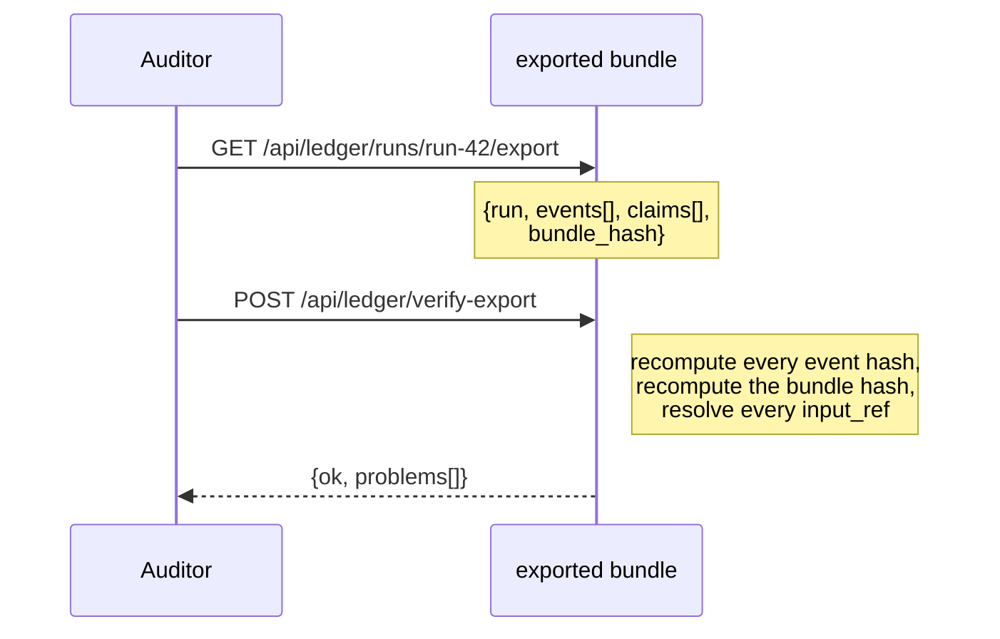

# The hash chain

## Why a chain and not a log

An append-only table of events is not auditable. It records that something
happened; it does not record that the record has not since been changed. Every
row in `ledger_events` commits to its predecessor:

```mermaid
flowchart LR
    G["genesis<br/>0000…0000"] --> E0["seq 0<br/>prev: 0000…<br/>hash: a3f1…"]
    E0 --> E1["seq 1<br/>prev: a3f1…<br/>hash: 7c22…"]
    E1 --> E2["seq 2<br/>prev: 7c22…<br/>hash: e914…"]
    E2 --> E3["seq 3<br/>prev: e914…<br/>hash: 02bd…"]

    style G fill:#30363d,stroke:#6e7681
    style E3 fill:#1f6feb22,stroke:#58a6ff
```

Edit any payload, delete any row, or insert a row after the fact, and the link
breaks. Verification recomputes the whole chain from the stored rows and names
the exact event where it stopped — and stops there, because once a link is
broken nothing after it can be trusted and continuing would report a cascade of
failures that are really one.

## The hashed core

Two exclusions, both deliberate:

**`proof_json`** is recomputable. Verification rebuilds it from the stored event
and reports drift rather than trusting the stored copy — a proof that had to be
trusted would not be a proof.

**`trace`** is an observation *about* the record: which request wrote this row.
It says when and under which request, not what the record claims. Folding it in
would change every event hash on disk and break verification of every run ever
written.

## What breaks what

| Tamper | Detected as | At seq |
|---|---|---|
| Edited payload | `hash_mismatch` | the edited event |
| Deleted row (head) | `seq_gap` | the following event |
| Deleted row (tail only) | `head_mismatch` | run level — every stored link is still internally consistent, so only the recorded head can catch it |
| Forged row, recomputed hash | `broken_link` | the *next* row, whose `prev_hash` still points at the row that was pushed out |
| Deleted claim referenced by an event | `unresolved_ref` | the citing event |
| Reordered rows | `seq_gap` | the first out-of-place row |
| Edited run label | nothing | `label` is not in the core — a cosmetic field, not a claim |

The forged-row case is the one worth dwelling on. A forger who recomputes
every hash correctly still cannot insert, because the next row's `prev_hash` is
already fixed. `test_insertion_breaks_the_chain` pins exactly this.

## Proofs

Every event gets a re-derivable artifact, attached outside the hash:

`verify_chain` reports `proof_drift` as a count, separate from `ok`. A missing
proof degrades the audit story without breaking the chain — it is derived state,
and treating its absence as evidence of tampering would be wrong.

## Claims, and what a bad one reaches

Two properties fall out of hashing the claim's *own content*:

1. **Parroting is detectable.** Two agents asserting the same thing produce the
   same `claim_hash`. "Did B simply restate A?" becomes a question with a
   yes/no answer.
2. **Blast radius is a query.** `GET /api/ledger/runs/{id}/contamination/{hash}`
   walks `input_refs` transitively and answers "if this claim was wrong, what
   did it reach?"

## Mandates — policy as data

A `Mandate` is hashed at run creation, so the rules in force when an action
happened are provable afterwards rather than inferred from whatever the code
says today.

Four rules of deliberately different force:

- **Hard boundary** — actors, intents, tools, domains. A violation is denied.
- **Soft shape** — `planned_intents`. An undeclared intent is *flagged, not
  refused*: a run that discovers a new step is fine, and a run that quietly
  stopped doing the work it declared is not.
- **Budget** — `max_events`, `max_llm_calls`.
- **Human gates** — kinds held for sign-off.

Every refusal also emits a `gate.check` event, so a violation can never be
scrolled past as a silent omission.

## Sessions — order across runs

Each browser sitting gets a spine:

The spine does not hold the work — it holds one `run.anchor` per task, in the
order the tasks were adopted. So each task still verifies independently, and the
session chain independently proves the *order* they happened in. One chain
implementation, not two.

A client key idle past `ECON_SESSION_IDLE_S` (default 30 min) starts a **new**
sitting: the old chain stays intact and verifiable, and new work anchors to a
fresh spine rather than to a chain that has been quiet for an hour.

## Self-verifying exports

No database, no application, no trust in the exporting process. The bundle
hash covers the content only — verification is *derived from* that content and
would otherwise be a self-referential field that changes the hash it is meant
to check.

The frontend runs this offline check before it tells you the bundle is good,
rather than asserting it.

## What is fail-open, and what is not

| Component | On failure | Why |
|---|---|---|
| `ledger.append` | Returns `None`, records a `LedgerAuditDrop` | A failed audit write must not kill the work it was recording |
| `llm.chat` audit block | Swallowed entirely | Same: the call succeeded; the record of it failing to be written is not the caller's problem |
| Session resolution in middleware | Proceeds unaudited | An audit outage must never become a product 500 |
| `monitor_integrity` | Returns the broken chains it found | It reports on failures; it must not add one |
| `verify_chain` | Reports the exact break and stops | Continuing past a break would report a cascade of failures that are really one |

The one thing that is **not** fail-open: `verify_chain` itself. It never
reports `ok` for a chain it could not verify. If the database cannot be read,
that is an error, not a pass.