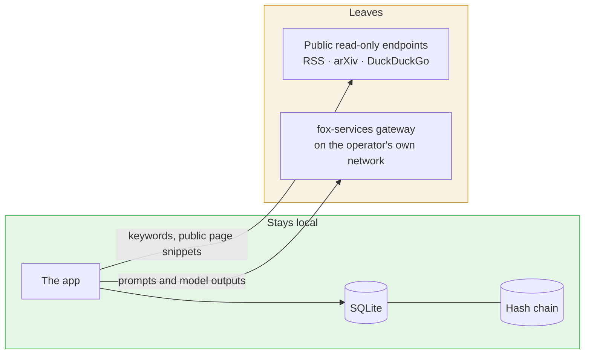
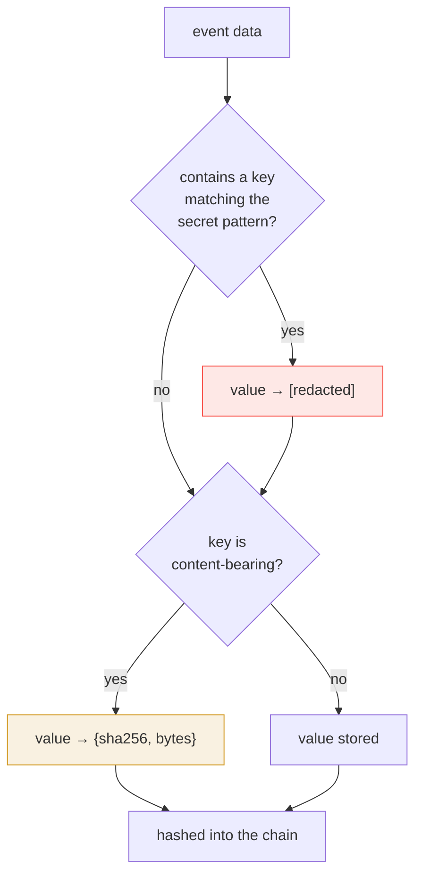
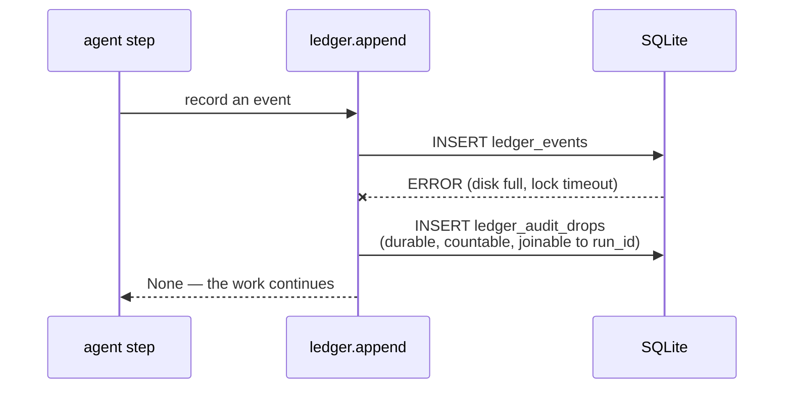
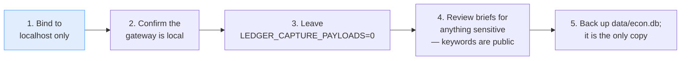

# Privacy

## What leaves this machine

That is the whole list. No telemetry endpoint, no outbound webhook, no
third-party analytics, no error reporting service.

**The one real egress** is model inference: prompts and completions go to the
gateway, which serves local Ollama or mesh peers on the same network. If that
gateway is pointed at a public API, prompts leave the machine — which is a
deployment decision, not something this app makes silently. The gateway URL and
whether it is reachable are on the header pill and in `GET /api/health`.

Search queries are keywords drawn from the investigation brief. If a brief
contains something sensitive, that keyword reaches public search engines and
RSS readers. The brief is the operator's to write.

## What is stored, and what is not

| Data | Stored | Notes |
|---|---|---|
| Prompt text | **digest only** | `prompt_sha256` + byte count. Enough to prove two calls carried the same content; not enough to read the conversation out of an append-only chain |
| Model output | **digest only** | `output_sha256`, same reasoning |
| Everything under a content-bearing key | **digest only** | `prompt`, `answer`, `transcript`, `completion`, `raw_html`, … — the *key name* is the signal, not the length |
| API keys, tokens, passwords | **redacted before write** | Recursive, on key name and on value shape (`sk-…`, `ghp_…`, JWTs) |
| Artifact titles, summaries, snippets | stored in full | This is the product. Without it there is no map |
| Source URLs | stored in full | Public by definition — they were fetched from public feeds |
| Tokens and latency per call | stored | Metadata, not content |

Two independent protections, because they catch different mistakes and neither
subsumes the other:

Redaction happens **before** the write, never after. The chain is append-only:
a secret that lands in one cannot be taken back out.

## The drop table

An audit write that fails is a hole in the product's evidence that its agents
did what they said. A hole that exists only as a line on stderr is a hole
nobody reads — it scrolls past, it is not queryable, and it leaves no count.
`LedgerAuditDrop` is where it goes instead, and the integrity monitor reports
the total next to the chain status.

**A chain can verify perfectly while the recorder has been failing for hours.**
That is why the monitor reports both, and why neither number alone is
sufficient.

## PII in generated content

`grounding.pii_scan` is deliberately conservative — it prefers missing to false
alarms:

| Situation | Which is worse |
|---|---|
| A missed email address | A review item |
| A false alarm on "Bank of England" | A redacted sentence of macro analysis, and one more reason to ignore the scanner |

It fires on email addresses, US SSNs, IBANs, API keys and PEM private keys —
high-confidence shapes only. It is a guard, not a DLP product, and the README
says so.

## What is *not* implemented

Stated plainly, because a privacy doc that lists only what was built reads as a
claim of more than is there.

- **No encryption at rest.** SQLite is a file on disk. Anyone who can read the
  file can read the artifacts. The *ledger* resists undetected tampering; it
  does not resist an attacker with write access.
- **No authentication.** The API binds to localhost and has no auth. It is a
  single-operator tool on a single machine. Exposing it beyond localhost
  exposes the whole database.
- **No multi-tenancy.** One database, one operator.
- **No retention policy.** Nothing expires. Nothing is deleted but what a person
  explicitly deletes.
- **No differential privacy.** Aggregate counts are published as-is. With few
  enough artifacts, a domain count can be identifying.
- **The gateway sees everything sent to it.** If `LLM_BASE_URL` points at a
  public API, prompts and completions leave the machine. The app does not
  redact prompts before sending them, because doing so would break the
  explainer.

## Operator checklist

1. **Bind to localhost.** `--host 127.0.0.1`. There is no auth.
2. **Confirm the gateway is yours.** `GET /api/health` shows `llm.served_by`.
   The header pill turns amber when a *fallback* is serving calls — a different
   gateway than the one you configured is answering.
3. **Leave `LEDGER_CAPTURE_PAYLOADS=0`.** Setting it stores prompt and
   completion bodies in the append-only chain, redacted for secrets but
   otherwise verbatim, and there is no way to take them back out.
4. **Review briefs.** Search keywords go to public endpoints.
5. **Back up `data/econ.db`.** It is the only copy of everything collected.