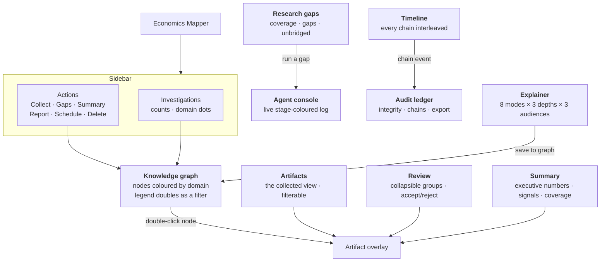
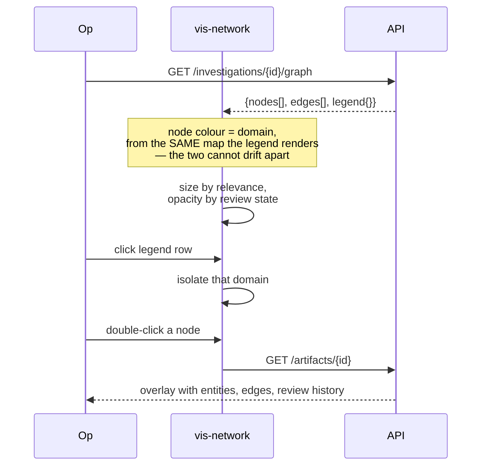
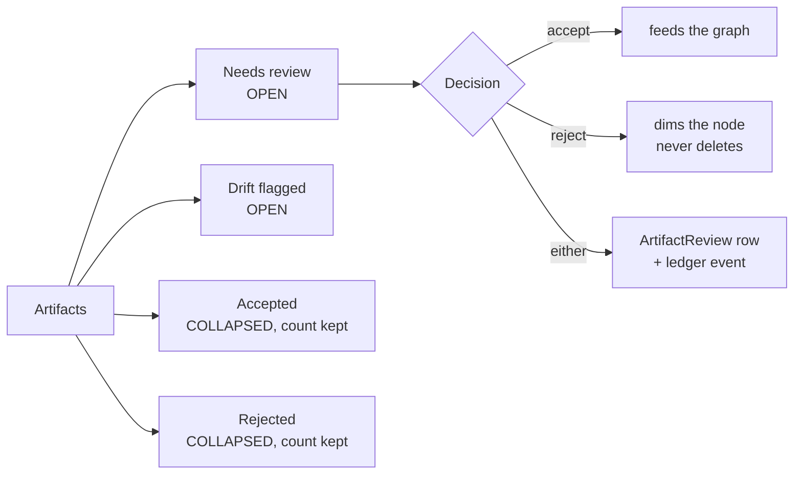
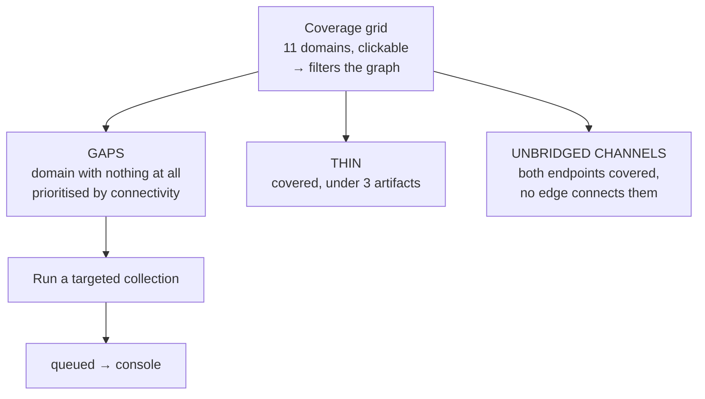
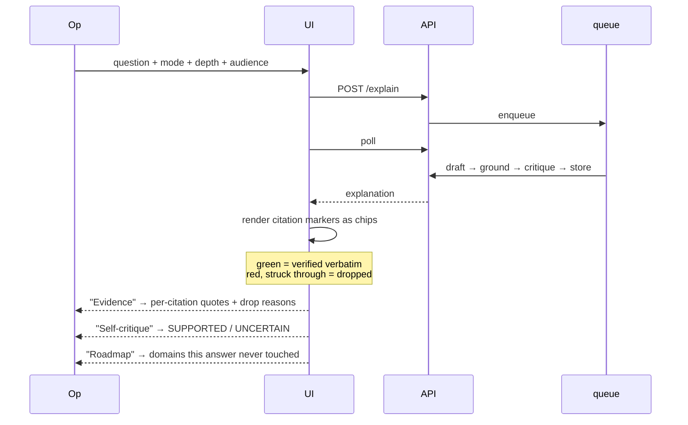
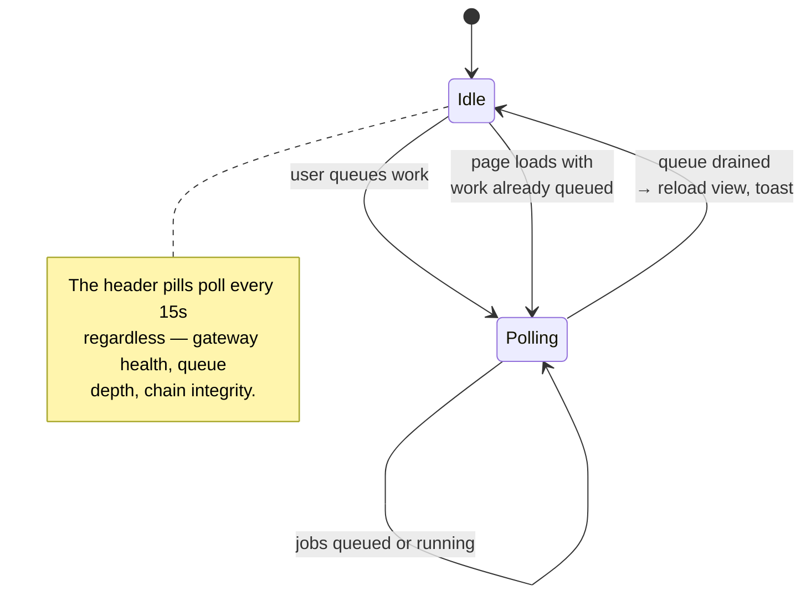

# UI interaction

## View map

Each view answers exactly one question:

| View | The question |
|---|---|
| Knowledge graph | What does this investigation actually connect? |
| Artifacts | What was collected, and what is it? |
| Review | What has not been judged yet? |
| Research gaps | What is *missing*, and where? |
| Explainer | What does the evidence say about this question? |
| Summary | What would I tell someone who asked for the whole thing? |
| Agent console | What is the agent doing right now? |
| Timeline | In what order did this happen? |
| Audit ledger | Can this be checked? |

## The graph

The legend being a **filter** rather than a static key is deliberate. A legend
you can click is a legend someone will click, and a filter that works is a claim
the map can actually support.

## The review queue

Needs-review and drift open by default; accepted and rejected are folded with
their counts in the header. A long run's triage should be scannable, not a wall
of cards — and the counts are what let someone decide *whether* to unfold it.

Both decisions are rows (`ArtifactReview`) and ledger events, not a flag on the
artifact. "Who reviewed what, when, and what did they say" is the question an
audit actually gets asked.

## Research gaps

Three lists, never one merged list. Collapsing *thin* into *empty* would let
"barely covered" read as "not covered", which is exactly how a map ends up
claiming coverage it does not have. And the unbridged list is the one that tells
you what is missing is a **mechanism**, not documents.

## The explainer

The chips are the point. A user can see *which* citations were verified and
which were dropped, rather than being told a count somewhere. And the
**Evidence** drawer separates drops that failed against a real article from
those that failed against a stored summary — a hallucination and a data gap are
different findings, and averaging them hides which happened.

When retrieval finds nothing, the explainer **refuses**, says why, and files a
research gap. That is rendered as a first-class outcome with a tag
(`no evidence — filed as a gap`), not as an error.

## Status and polling

Polling starts only when there is work, and stops the moment there is not. A
page that polls forever is a page that never sleeps.

## What the UI deliberately does not show

- **No coverage percentage.** "47% covered" is a number with no denominator a
  reader can check. The grid shows absolute counts per domain instead.
- **No composite risk score.** Combining eleven domains with different evidence
  densities into one number hides exactly the thing the app is for.
- **No confidence on the transmission prior.** The channels carry strengths, but
  the UI never renders them as certainty — they are a prior, and `unbridged
  channels` exists precisely because the evidence has not been gathered yet.
- **No "AI generated" badge on the artifact summary.** The summary is marked
  `source: explainer` where it belongs, and every artifact is one click from
  the URL it came from.